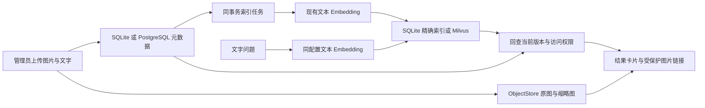

# 图片资料库与描述检索

这一版根据图片的**文字内容**找图：标题、人工说明、标签及已经获得的 OCR 使用现有文本 Embedding，召回后按资产 ID 回查元数据，再通过登录保护的接口读取原图。没有自动看图、共享图文向量空间或图片生成调用。只填标题也可以建立索引，补充准确的说明通常更利于业务检索。



## 本地使用

```powershell
uv sync
uv run adaptive-rag serve
```

打开 `http://127.0.0.1:8000/`，用管理员账号登录后进入「图片资料库」，也可直接打开 `/images`。普通账号可浏览、检索、查看原图和回放自己的检索记录；该页面的管理操作要求管理员。普通成员可在[文件中心](file-center.md)上传、修改和删除自己的图片；成员上传的图片默认仅本人可读。

1. 点击「添加图片资料」，选择 PNG、JPEG 或 WebP 静态图片，填写标题与说明，可补标签和已有 OCR。限制为 10MB，并校验实际图像解码与尺寸；不接收 SVG、动画或伪装文件。
2. 保存只写图片与元数据，不在上传请求里调用模型。
3. 默认无模型模式直接按文字检索，界面和 trace 明确标记 `lexical`，模型调用为零。待建语义索引任务保留，不能把文字检索成功视为已完成云端建索引。
4. 已显式启用云模型时，点击「处理待建索引」，或启动独立 worker。此操作会将图片说明文字发送到所配置的平台，复用已有文本 Embedding 模型。无模型模式下上传的旧图片，在开启云配置后先点击卡片「更新／重试索引」登记新配置任务，再执行处理；旧配置的任务和缓存不会冒充新配置向量。
5. 输入问题检索。卡片显示原图、缩略图、命中文字和排序分数；右侧显示 Trace ID、步骤状态、耗时与实际结构化返回。分数不是匹配概率。
6. 修改文字后重新处理索引；任务失败时先查看错误，再点击「更新／重试索引」并执行处理。更换 Embedding 配置后也需要为当前配置登记并处理索引。

历史回放使用 `/assets/traces/{trace_id}`，只允许原查询身份读取。回放时重新检查图片当前版本和权限；版本变化、删除或撤权后，旧记录可能返回不可访问，避免借历史记录绕过当前权限。

## 接口与任务入口

| 方法 | 路径 | 行为 |
| --- | --- | --- |
| GET | `/assets`、`/assets/{id}` | 列表与当前元数据 |
| POST | `/assets` | 管理员上传，JSON 中传 Base64 文件 |
| PATCH | `/assets/{id}` | 管理员修改，必须传 `expected_revision` |
| DELETE | `/assets/{id}?expected_revision=...` | 管理员删除，建议传当前版本以检测并发修改；删除后 `asset_id` 可再次用于上传 |
| GET | `/assets/{id}/content`、`/assets/{id}/thumbnail` | 登录后按当前权限读取原图或缩略图 |
| POST | `/assets/search` | `{question, top_k}`，返回结果与 trace |
| GET | `/assets/traces/{id}` | 当前查询身份回放记录 |
| POST | `/assets/{id}/reindex` | 显式登记当前配置任务或重试失败任务 |
| POST | `/assets/index` | 管理员执行本租户一批任务，`limit` 默认为 10 |

接口沿用工作台 Cookie 与可选 Bearer 客户端，正文不能指定可信租户或身份。元数据中的非空 `allowed_subjects` 同时约束读写；通过 API 配置限制时，需要保留管理者身份才能继续管理。页面上传默认向当前租户开放。

```powershell
uv run adaptive-rag --env-file .env assets-index --tenant demo --limit 10
```

持续 worker 接受进程环境注入，不会隐式读取根目录 `.env`：

```powershell
uv run python -m adaptive_rag.asset_worker --tenant demo --interval 10
```

worker 与 API 必须使用相同的数据目录、存储选择、租户和 Embedding 配置。后台 worker 只能自动处理尚未执行的任务，失败或进程中断的付费任务要求显式重试；已成功生成并持久化的向量可复用，外部索引写入失败不会因此重复生成这些向量。无法确认云端是否已计费的中断不能承诺恰好一次计费。

## 存储与一致性

公开配置模板见 [`deploy/storage.env.template`](../deploy/storage.env.template)。远程存储必须显式启用 `RAG_ENABLE_REMOTE_STORAGE=true`；这个开关只允许存储网络访问，不会启用云模型。模型继续由 `RAG_ENABLE_CLOUD=true` 独立控制。

| 数据 | 默认后端 | 可选后端 | 角色 |
| --- | --- | --- | --- |
| 文档知识与 trace | SQLite | PostgreSQL | 版本、权限与诊断 |
| 图片元数据、版本、任务与图片 trace | SQLite | PostgreSQL | 权威资产记录与持久化任务 |
| 原文、原图及缩略图 | 内容寻址本地文件 | S3 兼容对象存储 | 原始字节与完整性校验 |
| 图片文字向量 | SQLite 精确余弦 | Milvus | 可重建的派生索引 |
| 账号与登录会话 | SQLite | 本轮保持 SQLite | 独立持久化文件 |

配置选择不会自动迁移现有数据。图片元数据与任务在同一数据库事务内写入；对象存储和向量索引属于事务外效果。上传中断可能留下未被引用的对象，但不会发布缺少对象的资产。删除先撤销可见性，再通过任务清理向量；文件在回收站中保留 168 小时，期间可按权限恢复。到期后由已配置的维护任务核对引用，清理不再使用的内容。详见[运维条件](../deploy/retention/README.md)。

**删除后复用 `asset_id`：** 已删除图片的 `asset_id` 可以再次上传，得到全新的版本并重新登记索引；仍存在的 `asset_id` 继续返回 409，提示用 `expected_revision` 修改。向量清理任务按 `asset_id` 删除全部向量，所以重新上传会先取消尚未执行（待处理或已失败）的清理任务，避免它事后抹掉新图的向量；留下的旧版本向量在回查时因版本不符被忽略，并在新图再次删除时一并清理。清理任务正在执行时重新上传返回 409，稍候重试即可。

检索先按租户及 Embedding 配置查询派生向量，再核验当前资产版本、状态和权限，不能把向量命中本身作为授权依据。旧向量或外部服务延迟不能让已删除、旧版本或越权图片出现在有效结果中。

## 当前边界

- 图片检索是独立入口，尚未自动混入知识库对话的证据与答案。
- PDF 里的插图不进入图片资料库：MinerU 解析出的插图随文档保存、跟着证据显示（见[文档里的插图](figures.md)）。图片资料库本身不自动 OCR，也不自动继承来源文档 ACL。`source_document_id` 与页码目前只记录来源元数据，不能作为已实现来源权限联动的证明。
- 图片检索当前不使用 Reranker；语义分数和文字分数属于各自排序方式，不跨方式直接比较。
- 当前一次语义检索最多取 1000 个候选表示，再去重和检查权限；达到上限时 trace 标记 `candidate_limit_reached=true`。旧版本向量暂未自动清理，大量版本或低权限账号可能因此召回不足，应在扩大数据量前补索引维护与更细的候选过滤。
- Milvus 适配本轮面向图片文字索引；文档 dense 检索仍沿用原有实现与缓存，不因启用图片 Milvus 而自动迁移。
- 多后端接入、本地验收和部署配置不代表已完成线上数据迁移、业务质量评测或高可用部署。服务器切换需独立验证备份、恢复、资源容量和租户配置。
- Laya 继续预留接口；后续图片生成应通过独立生成接口写入相同资产服务，而不是把语义找图声称为生成图片。
